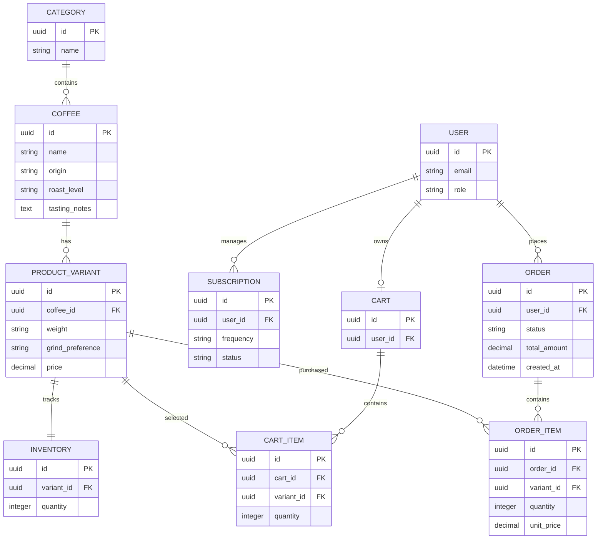

# Bean Boutique — Coffee E-Commerce Platform

**Bean Boutique** is a coffee e-commerce platform designed to provide customers with a seamless online shopping experience for premium coffee products.

The platform enables customers to explore coffee collections, customize product preferences, place orders, and manage subscriptions through a centralized digital storefront.

Built with a Django-powered backend, Bean Boutique focuses on secure authentication, efficient product management, inventory control, and reliable order processing.

---

## Project Vision

To create a modern digital coffee marketplace that connects coffee enthusiasts with quality coffee products through an intuitive, secure, and scalable e-commerce experience.

## Core Features

### 1. User Management & Authentication

Bean Boutique supports role-based user management with different levels of access.

**User roles:**

| Role | Responsibilities |
|---|---|
| ADMIN | Manages the entire platform |
| ROASTER | Manages coffee products and roasting information |
| WAREHOUSE | Manages inventory and stock operations |
| CUSTOMER | Browses products and places orders |

Features:
- User registration and authentication.
- JWT-based authentication.
- Custom user model.
- Role-based access control.
- User profile management.
- Secure password management.

### 2. Coffee Catalog Management

- Create and manage coffee products.
- Organize coffee into categories.
- Display coffee descriptions and tasting notes.
- Manage product images.
- Manage coffee origins and roast profiles.
- Search and filter available products.

### 3. Product Variants

Customers can select different product configurations.

Examples:
- Coffee weight (250g, 500g, 1kg).
- Grind preference.
- Whole bean or ground coffee.
- Product-specific pricing.

**Default grind preference:** Whole Bean.

### 4. Inventory Management

- Track available stock.
- Update inventory quantities.
- Monitor low-stock products.
- Manage warehouse operations.
- Prevent orders exceeding available inventory.
- Track stock movements.

### 5. Shopping Cart & Orders

- Add products to cart.
- Update cart quantities.
- Remove products.
- Calculate order totals.
- Place orders.
- Track order status.
- View order history.

### 6. Coffee Subscriptions

Allow customers to subscribe to recurring coffee deliveries.

Potential subscription features:
- Weekly, biweekly, and monthly subscriptions.
- Select preferred coffee products.
- Choose delivery quantities.
- Manage subscription status.
- Pause, resume, or cancel subscriptions.

---

## Technology Stack

| Component | Technology |
|---|---|
| Backend Framework | Django |
| API Framework | Django REST Framework |
| Database | PostgreSQL / SQLite (development) |
| Authentication | JWT |
| ORM | Django ORM |
| API Documentation | Swagger / OpenAPI |
| Package Management | uv |
| Testing | Django Test Framework / Pytest |
| Version Control | Git & GitHub |
| Containerization | Docker (optional) |

---

## System Architecture

Bean Boutique follows a modular backend architecture, separating the different business domains of the e-commerce platform.

```text
                 CLIENT APPLICATION
                    (Web / Mobile)
                          |
                          v
                     REST API
                          |
                          v
                DJANGO REST FRAMEWORK
                          |
          +---------------+---------------+
          |               |               |
          v               v               v
        USERS           CATALOG          ORDERS
          |               |               |
          v               v               v
     AUTHENTICATION    INVENTORY       SUBSCRIPTIONS
          |               |               |
          +---------------+---------------+
                          |
                          v
                      DJANGO ORM
                          |
                          v
                      DATABASE
```

### Architectural Responsibilities

- **Django:** Core business logic and backend infrastructure.
- **Django REST Framework:** REST API endpoints and serializers.
- **Django ORM:** Database operations and relationship management.
- **JWT:** Secure authentication and protected endpoints.
- **PostgreSQL:** Persistent relational data storage.

---

## Database Design

The initial database design focuses on the main e-commerce entities.

| Entity | Responsibility |
|---|---|
| User | Customer and staff accounts |
| Coffee | Coffee product information |
| ProductVariant | Different product configurations |
| Category | Coffee product categorization |
| Inventory | Available stock quantities |
| Cart | Customer shopping cart |
| CartItem | Products inside a cart |
| Order | Customer purchase records |
| OrderItem | Individual products within an order |
| Subscription | Recurring coffee orders |

### User Roles

```text
ADMIN
ROASTER
WAREHOUSE
CUSTOMER
```

### Order Lifecycle

Orders follow a structured lifecycle:

- `PENDING` — Order has been created.
- `CONFIRMED` — Order has been confirmed.
- `PROCESSING` — Order is being prepared.
- `SHIPPED` — Order has been dispatched.
- `DELIVERED` — Order has been delivered.
- `CANCELLED` — Order has been cancelled.

### Entity Relationship Diagram



---

## Project Structure

```text
bean-boutique/
│
├── config/
│   ├── settings.py
│   ├── urls.py
│   ├── asgi.py
│   └── wsgi.py
│
├── apps/
│   ├── users/
│   ├── catalog/
│   ├── inventory/
│   ├── cart/
│   ├── orders/
│   └── subscriptions/
│
├── tests/
│
├── docs/
│   ├── architecture/
│   ├── database/
│   └── api/
│
├── .env.example
├── .gitignore
├── manage.py
├── pyproject.toml
└── README.md
```

---

## Getting Started

### Prerequisites

- Python 3.12+
- PostgreSQL
- Git
- uv

### 1. Clone Repository

```bash
git clone https://github.com/YOUR_USERNAME/bean-boutique.git

cd bean-boutique
```

### 2. Install Dependencies

```bash
uv sync
```

### 3. Configure Environment Variables

Create a `.env` file:

```env
DEBUG=True
SECRET_KEY=your-secret-key

DB_NAME=bean_boutique
DB_USER=your-database-user
DB_PASSWORD=your-database-password
DB_HOST=localhost
DB_PORT=5432
```

### 4. Apply Database Migrations

```bash
uv run python manage.py makemigrations

uv run python manage.py migrate
```

### 5. Create Administrator

```bash
uv run python manage.py createsuperuser
```

### 6. Start Development Server

```bash
uv run python manage.py runserver
```

The application will be available at:

`http://127.0.0.1:8000/`

---

## API Endpoints

The following endpoints represent the planned API structure.

### Authentication

| Method | Endpoint | Description |
|---|---|---|
| POST | `/api/v1/users/register/` | Register customer |
| POST | `/api/v1/users/login/` | Authenticate user |
| POST | `/api/v1/users/token/refresh/` | Refresh JWT |
| GET | `/api/v1/users/me/` | Retrieve current user |

### Coffee Catalog

| Method | Endpoint | Description |
|---|---|---|
| GET | `/api/v1/catalog/coffees/` | List coffees |
| POST | `/api/v1/catalog/coffees/` | Create coffee |
| GET | `/api/v1/catalog/coffees/{id}/` | Retrieve coffee |
| PUT | `/api/v1/catalog/coffees/{id}/` | Update coffee |
| DELETE | `/api/v1/catalog/coffees/{id}/` | Delete coffee |

### Product Variants

| Method | Endpoint | Description |
|---|---|---|
| GET | `/api/v1/catalog/variants/` | List variants |
| POST | `/api/v1/catalog/variants/` | Create variant |
| GET | `/api/v1/catalog/variants/{id}/` | Retrieve variant |

### Inventory

| Method | Endpoint | Description |
|---|---|---|
| GET | `/api/v1/inventory/` | Retrieve stock |
| PATCH | `/api/v1/inventory/{id}/` | Update stock |

### Cart

| Method | Endpoint | Description |
|---|---|---|
| GET | `/api/v1/cart/` | Retrieve cart |
| POST | `/api/v1/cart/items/` | Add item |
| PATCH | `/api/v1/cart/items/{id}/` | Update quantity |
| DELETE | `/api/v1/cart/items/{id}/` | Remove item |

### Orders

| Method | Endpoint | Description |
|---|---|---|
| GET | `/api/v1/orders/` | List customer orders |
| POST | `/api/v1/orders/` | Place an order |
| GET | `/api/v1/orders/{id}/` | Retrieve order details |

### Subscriptions

| Method | Endpoint | Description |
|---|---|---|
| GET | `/api/v1/subscriptions/` | List subscriptions |
| POST | `/api/v1/subscriptions/` | Create subscription |
| PATCH | `/api/v1/subscriptions/{id}/` | Update subscription |
| DELETE | `/api/v1/subscriptions/{id}/` | Cancel subscription |

---

## Security Considerations

Security is a core requirement of Bean Boutique.

- JWT authentication.
- Secure password hashing.
- Role-based access control.
- Customer-specific order access.
- Inventory validation.
- Input validation and sanitization.
- Secure environment variable management.
- Protection against unauthorized administrative operations.
- Transaction-safe order processing.

---

## Testing

Automated tests should cover:

- User registration and authentication.
- Role-based permissions.
- Coffee catalog operations.
- Product variant management.
- Inventory updates.
- Shopping cart operations.
- Order creation and processing.
- Subscription management.
- Customer data isolation.

Run tests:

```bash
uv run python manage.py test
```

---

## Development Roadmap

| Phase | Deliverable | Status |
|---|---|---|
| 1 | Project setup and configuration | Planned |
| 2 | Custom user model and authentication | Planned |
| 3 | Coffee catalog and product variants | Planned |
| 4 | Inventory management | Planned |
| 5 | Shopping cart | Planned |
| 6 | Order management | Planned |
| 7 | Subscription management | Planned |
| 8 | Payment integration | Planned |
| 9 | Automated testing | Planned |
| 10 | Deployment | Planned |

---

## Future Enhancements

- Payment gateway integration.
- Customer reviews and ratings.
- Discount codes and promotional campaigns.
- Personalized coffee recommendations.
- Automated subscription billing.
- Email and order notifications.
- Delivery tracking.
- Sales and inventory analytics.
- Loyalty and rewards program.
- Admin dashboard.

---

## Contributing

Contributions are welcome.

1. Fork the repository.
2. Create a feature branch.
3. Implement your changes.
4. Write and run relevant tests.
5. Submit a pull request.

---

## License

This project is currently under development.

---

**Bean Boutique**

*Every cup tells a story. Every bean matters.*
